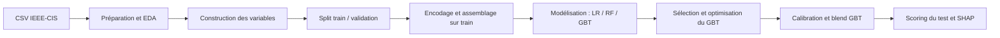
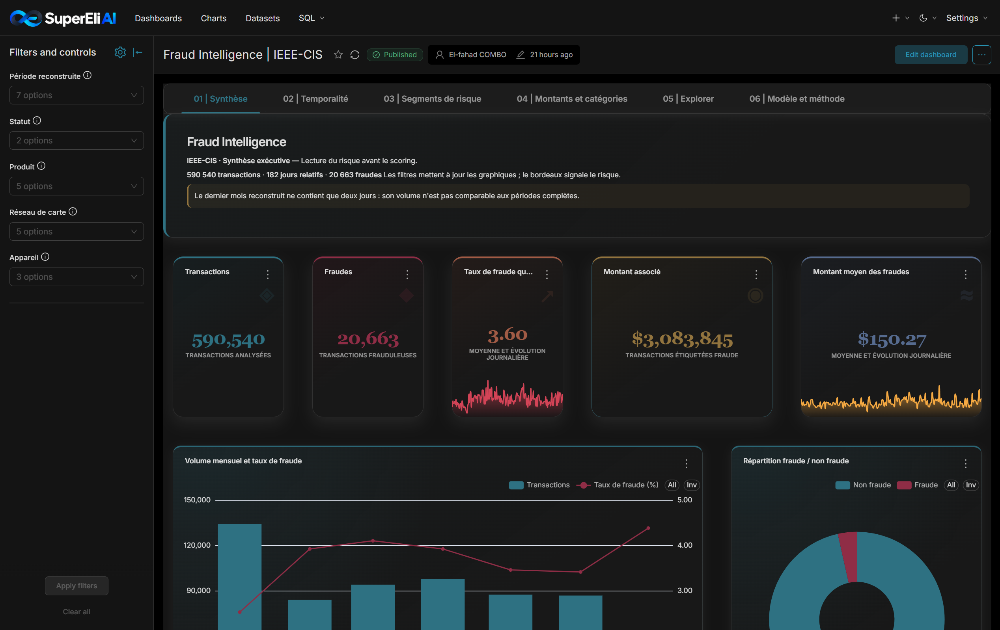
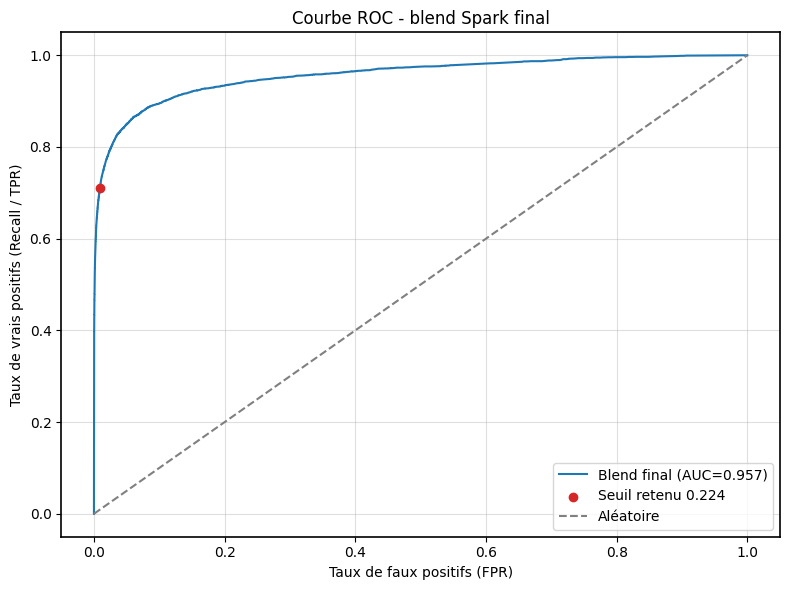
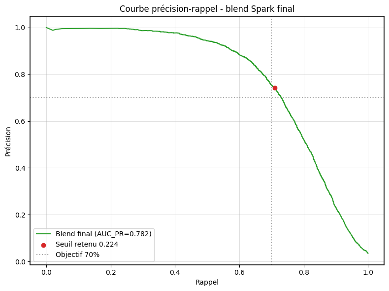
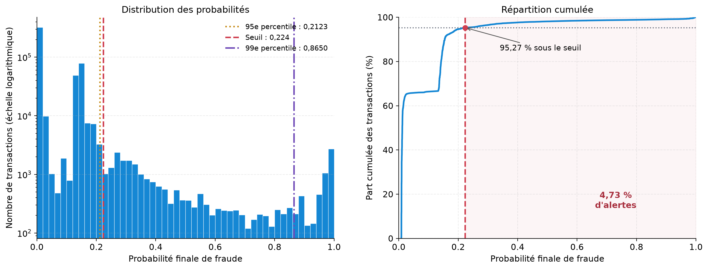
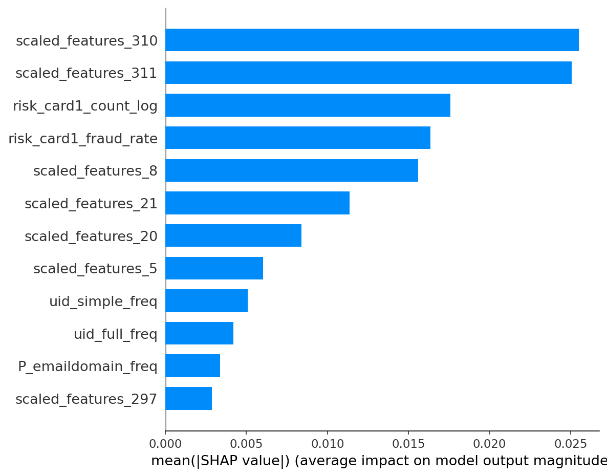
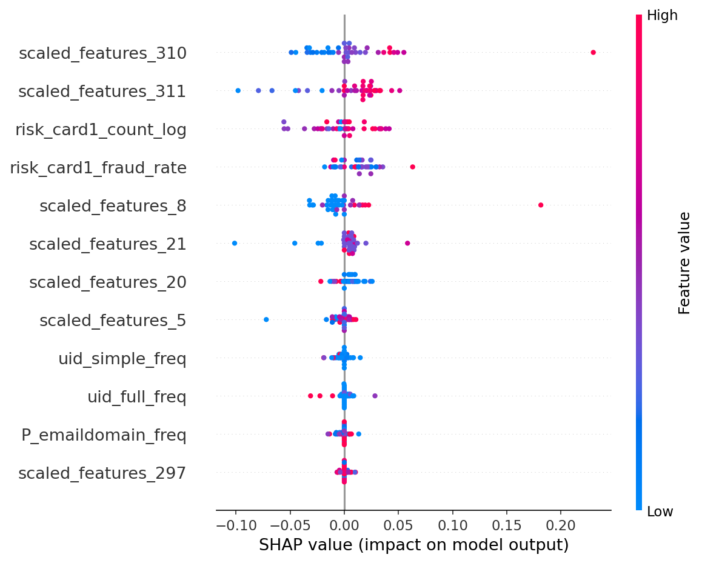
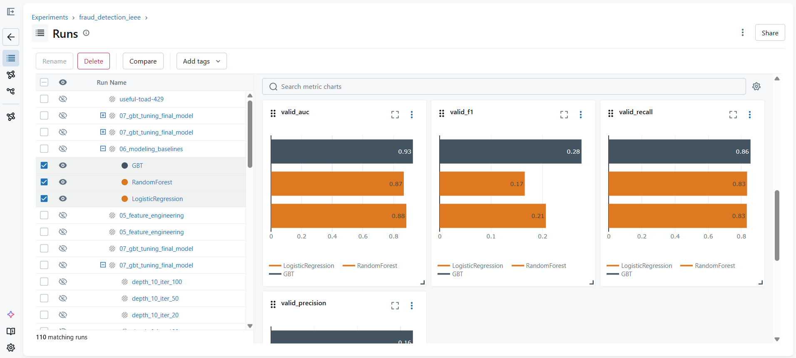

# Détection de fraude bancaire avec PySpark

Pipeline de Machine Learning consacré à la détection de transactions frauduleuses à partir du jeu de données **IEEE-CIS Fraud Detection**. Le projet couvre la préparation distribuée des données, l'analyse exploratoire, le feature engineering, la comparaison de modèles, l'optimisation d'un ensemble de GBT, le suivi avec MLflow, le scoring du test et l'interprétation avec SHAP.

> Projet universitaire initialement présenté à l'Université de Caen Normandie en juillet 2025 sous la forme d'un notebook monolithique. Cette version restructurée et enrichie a été réalisée personnellement après la soutenance afin d'obtenir un pipeline plus reproductible, lisible et exploitable.

## Résultats principaux

Le périmètre d'entraînement contient **590 540 transactions**, dont **20 663 fraudes**, soit environ **3,5 %** des observations. Le modèle retenu est un blend probabiliste de trois GBT complémentaires.

| Modèle | AUC-ROC | AUC-PR | F1-score | Précision | Rappel | Exactitude | Seuil |
|---|---:|---:|---:|---:|---:|---:|---:|
| **Blend final** | **0,9569** | **0,7824** | **0,7257** | **0,7415** | **0,7106** | **0,9813** | **0,224** |

Sur les **506 691 transactions non étiquetées** du test, le pipeline produit **23 943 alertes**, soit un taux d'alerte de **4,73 %**. L'absence de la cible `isFraud` empêche cependant de calculer des métriques de performance sur ce jeu.

## Objectifs du projet

- traiter un volume important de données avec PySpark ;
- prévenir les fuites de données en séparant entraînement et validation avant les transformations apprises ;
- construire des variables temporelles, comportementales et de risque ;
- comparer la régression logistique, la forêt aléatoire et le GBT ;
- améliorer le compromis entre détection des fraudes et fausses alertes ;
- suivre les expériences et conserver leurs paramètres avec MLflow ;
- interpréter les décisions finales avec SHAP.

## Pipeline



Les paramètres des encodeurs, du `StandardScaler`, des fréquences et des statistiques de risque sont appris uniquement sur l'entraînement, puis appliqués sans réajustement à la validation et au test.

## Structure du dépôt

```text
Fraud_Detection_IEEE/
├── docs/
│   └── img/                     # Figures utilisées dans la documentation
├── notebooks/
│   ├── 01_setup_load_merge.ipynb
│   ├── 02_eda_brut.ipynb
│   ├── 03_quality_cleaning.ipynb
│   ├── 04_eda_advanced.ipynb
│   ├── 05_feature_engineering.ipynb
│   ├── 06_modeling_baselines.ipynb
│   ├── 07_gbt_tuning_final_model.ipynb
│   └── 08_test_preparation.ipynb
├── src/
│   ├── fraud_pipeline.py        # Fonctions partagées du pipeline
│   └── inference.py             # Chargement et prédiction avec le blend
├── .gitignore
├── main.py                      # Interface d'inférence
├── README.md
└── requirements.txt
```

## Parcours des notebooks

| Notebook | Contenu principal |
|---|---|
| `01_setup_load_merge.ipynb` | configuration de Spark, chargement et jointure des tables transaction et identité |
| `02_eda_brut.ipynb` | analyse exploratoire initiale, cible, montants et variables catégorielles |
| `03_quality_cleaning.ipynb` | qualité des données, valeurs manquantes, doublons et nettoyage |
| `04_eda_advanced.ipynb` | analyses temporelles, comportementales et synthèse Superset |
| `05_feature_engineering.ipynb` | construction des variables, split, encodages, statistiques de risque et assemblage |
| `06_modeling_baselines.ipynb` | régression logistique, forêt aléatoire, GBT et analyse des erreurs |
| `07_gbt_tuning_final_model.ipynb` | sélection des variables, tuning, calibration, pondération et blend final |
| `08_test_preparation.ipynb` | alignement du test, scoring, export, importance et interprétation SHAP |

## Modélisation

### Modèles de base

Les trois modèles sont évalués sur le même échantillon reproductible de validation, avec un seuil préliminaire de 0,4 pour les métriques de classification.

| Modèle | AUC-ROC | AUC-PR | F1 | Précision | Rappel |
|---|---:|---:|---:|---:|---:|
| Régression logistique | 0,8840 | 0,2438 | 0,2064 | 0,1178 | 0,8325 |
| Forêt aléatoire | 0,8673 | 0,3960 | 0,1655 | 0,0918 | 0,8341 |
| **GBT** | **0,9268** | **0,5778** | **0,2758** | **0,1644** | **0,8551** |

Le GBT offre la meilleure capacité de classement, mais son seuil initial génère encore de nombreuses fausses alertes. L'analyse des erreurs guide alors la création de variables ciblées et de statistiques de risque.

### Optimisation et blend final

L'optimisation comprend :

1. la sélection des attributs `Vxx` à partir de leur importance GBT et de leur corrélation avec la cible ;
2. la construction d'un vecteur final de **725 dimensions** ;
3. le réglage de `maxDepth` et `maxIter` ;
4. une calibration isotonique des probabilités ;
5. deux variantes pondérant davantage la classe frauduleuse ;
6. une moyenne pondérée des probabilités des trois GBT.

La combinaison finale est la suivante :

```text
20 % GBT de référence + 25 % GBT pondéré ×1,15 + 55 % GBT pondéré ×1,30
```

Le seuil final de **0,224** est appliqué aux probabilités calibrées du blend, et non directement aux probabilités individuelles des trois modèles.

## Visualisations

### Tableau de bord exploratoire

Apache Superset a été utilisé pour centraliser les indicateurs, filtrer les segments et explorer les dimensions temporelles, transactionnelles et catégorielles.



### Courbes finales

| ROC | Précision-rappel |
|---|---|
|  |  |

### Scoring du test



### Interprétation SHAP

L'interprétation porte sur un échantillon de 40 transactions du test et sur les 12 variables principales du blend.

| Importance moyenne | Sens des contributions |
|---|---|
|  |  |

Les statistiques associées à `card1` dominent l'explication locale, devant plusieurs variables standardisées issues des compteurs `C`, les fréquences des profils `uid` et le domaine e-mail.

## Installation

```bash
git clone https://github.com/elfahad98/ieee-fraud-pyspark.git
cd ieee-fraud-pyspark
pip install -r requirements.txt
```

## Inférence

Après l'exécution des notebooks et la génération locale des artefacts, `main.py` permet d'interroger le blend final.

```bash
# Une transaction précise
python main.py --transaction-id 3739183 --chart

# Une liste d'identifiants
python main.py --ids-file ids.csv --output predictions.csv

# De nouvelles tables IEEE-CIS
python main.py --score-csv new_transactions.csv --identity-csv new_identity.csv

# Mode interactif
python main.py --interactive
```

L'inférence nécessite les modèles, calibrateurs et métadonnées produits par les notebooks. Ces artefacts volumineux restent volontairement hors du dépôt Git.

## Suivi des expériences

MLflow centralise les paramètres, métriques et artefacts des modèles de base, des essais d'optimisation et du blend final.



## 👤 Auteur

Projet réalisé par **COMBO El-Fahad** – Université de Caen Normandie (2025).  
Contact : `elfahad180@gmail.com`

---

## 📄 Licence

Ce projet est sous licence **MIT**. Voir le fichier `LICENSE`.
